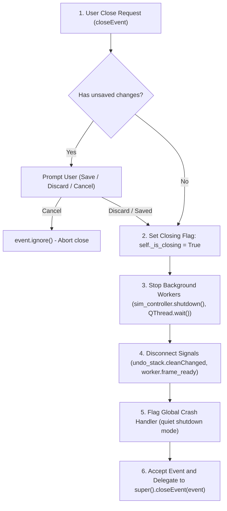

# Learning Notes — CircuitSim

## Milestone 3 — Step 3A: How Saving and Loading Work

### Files to read first
1. [`src/circuitsim/io/circ_serializer.py`](src/circuitsim/io/circ_serializer.py) — turns a circuit into JSON text and back. No Qt in it, so it is easy to test.
2. [`src/circuitsim/canvas/scene.py`](src/circuitsim/canvas/scene.py) — `to_document()` and `load_document()`.
3. [`src/circuitsim/app/main_window.py`](src/circuitsim/app/main_window.py) — the File menu code (`open_path`, `save_to_path`, the unsaved-changes prompt).
4. [`tests/test_circ_io.py`](tests/test_circ_io.py) — shows every kind of bad file we protect against.

### The ideas in plain language
- **What is in a `.circ` file?** Just text (JSON) with a list of parts, a list of wires and a few view settings. Every part is stored as its *type* (`"resistor"`), its *name*, where it sits, how it is rotated, and its values. To load it we ask a small factory for a fresh default resistor and then copy the saved values into it.
- **Why a version number?** Later versions of the program may store more things. `"schema_version": 1` lets an old program say "this file is from a newer CircuitSim" instead of crashing on something it does not understand.
- **Why validate so strictly?** A file can be damaged (disk problem), cut short, edited by hand, or not a circuit at all. Every value is checked (a resistor of "-5 ohm", a rotation of 45 degrees, two parts with the same name...) and we report a plain sentence such as *"The file is empty."*
- **All-or-nothing loading.** `load_document()` first builds *all* new items on the side. Only when everything worked does it throw away the old circuit and insert the new items. If anything fails, the old circuit was never touched — that is the same idea as a database *transaction*.
- **Atomic saving.** If the program wrote straight into your file and the power failed halfway, you would lose both the old and the new version. Instead we (1) write a temporary file next to it, (2) force it onto the disk (`fsync`), (3) copy the old file to `name.circ.bak`, and (4) rename the temporary file over the real one with `os.replace`. Renaming is a single step the operating system finishes completely or not at all.
- **The `*` in the title.** Qt's `QUndoStack` remembers a "clean" point. After saving we call `setClean()`; any edit moves away from that point (asterisk), and undoing back to it removes the asterisk again.

### Three exercises
1. Save a circuit, open the `.circ` file in Notepad, change `"resistance": 1000.0` to `4700.0`, and open it in CircuitSim. Which value is shown on the canvas?
2. In Notepad change `"rotation_deg": 90` to `45` and open the file. Read the message. Then delete the last `}` of the file and try again — how do the two messages differ?
3. Save a circuit twice with a change in between. Open `yourfile.circ.bak` — which version is in it? Why is this useful?

---

## Milestone 2 — Step 2C: Live Simulation Session, Background `QThread` Worker, Upright Labels & Canvas Telemetry

In **Step 2C**, we brought the schematic canvas to life! Pressing **Run (`F5`)** solves your schematic continuously in a background worker thread while updating live voltmeter/ammeter readouts, lightbulb glow, switch animations, and problem highlighting on the canvas without ever freezing the GUI.

---

### 1. Which Files to Read First (Step 2C)

1. [`src/circuitsim/engine/simulation_session.py`](src/circuitsim/engine/simulation_session.py) — **Pure Python (zero Qt imports!)**. Defines `SimulationSession`, `SimulationBackendProtocol`, `SimulationFrame`, `ComponentTelemetry`, and `ProblemDiagnostic`. Because every command and output frame is a plain, picklable Python dataclass, you can run and test a full interactive simulation session without opening a window—or move the worker to a separate `multiprocessing.Process` later if needed.
2. [`src/circuitsim/app/sim_worker.py`](src/circuitsim/app/sim_worker.py) — Wraps `SimulationSession` inside `_SessionThreadWorker` on a background `QThread`, communicating with `MainWindow` strictly via queued Qt signals (`Qt.ConnectionType.QueuedConnection`).
3. [`src/circuitsim/canvas/component_item.py`](src/circuitsim/canvas/component_item.py) — Renders upright component labels/values under any rotation or flip, animates the switch blade with `QVariantAnimation`, draws the lightbulb's power-based radial glow and overload badge (`>100%!`), and outlines components with errors (red) or warnings (amber).
4. [`src/circuitsim/dialogs/quick_edit_dialog.py`](src/circuitsim/dialogs/quick_edit_dialog.py) — Builds a compact double-click editor dynamically from each component's `get_editable_parameters()` descriptor list (`ComponentParameter` in [`base.py`](src/circuitsim/components/base.py)), validates entries with `parse_engineering_value`, and applies changes live while running.

---

### 2. Plain-Language Explanations of Key Concepts (Step 2C & Usability Polish)

1. **What a `QThread` Is and Why the Solver Runs on One**:
   - In a desktop app, the **main thread** (also called the GUI thread) has one job: draw the window and respond immediately when you move the mouse, click buttons, drag parts, or press keys. If the main thread spends even `200 ms` solving matrices in a `while` loop, the whole window stops responding and the operating system marks it *"Not Responding"*.
   - A **`QThread`** is Qt's way of running a second event loop in the background alongside the main GUI thread. Our solver worker (`_SessionThreadWorker` in [`sim_worker.py`](src/circuitsim/app/sim_worker.py)) lives on that background `QThread`. Every ~33 ms (~30 times per second), it steps the circuit equations forward by a small chunk of time and sends a finished snapshot (`SimulationFrame`) back to the main thread over a **queued Qt signal**. Because the main thread only paints the snapshot that arrived, panning, zooming, and clicking switches stay smooth even on a 30-resistor ladder + $RC$ circuit!

2. **What `SimulationSession` Does**:
   - [`SimulationSession`](src/circuitsim/engine/simulation_session.py) is the "conductor" between your schematic drawing and the math solver (`MNASolver`). It has **zero Qt imports**, so it can run in pure Python or inside a test without opening a window.
   - When you press **Run (`F5`)**, `SimulationSession` takes the placed components and wires, extracts the electrical netlist (ignoring any completely unconnected part with a gentle warning so the rest of the circuit can still run), solves the DC operating point and transient steps, updates every meter and lightbulb, and packages all voltages, currents, powers, and problem diagnostics into an immutable `SimulationFrame`.
   - It also handles live actions—like toggling a switch (`toggle_switch`) or editing a component's value (`update_component_parameter`)—and immediately recomputes the circuit state so you see the new reading right away.

3. **Why Labels Stay Upright When Rotated (and Clear of the Selection Box)**:
   - If you rotate a whole Qt graphics item by `90°`, `180°`, or `270°` (or flip it horizontally), Qt rotates or mirrors *everything* drawn inside that item—including text—so `"R1"` and `"1 kΩ"` would appear upside-down, vertical, or mirror-reversed.
   - Instead, [`ComponentItem`](src/circuitsim/canvas/component_item.py) keeps the item's own transform at `0°` (`isIdentity() == True`). Inside `paint()`, we temporarily rotate/flip the `QPainter` *only* while drawing the electrical symbol and its selection box, then restore the painter to `0°` before drawing the text.
   - We also position the upright text rectangles outside the `±23 px` selection outline (above and below the symbol when horizontal at `0°`/`180°`, or to the right of the symbol when vertical at `90°`/`270°`) so the dashed selection frame never cuts through the label or value text.

4. **Why Comma and Dot Decimals Need Care (`"5,65 G"` vs. `"1,234.5"`)**:
   - In many countries (such as Croatia, Germany, and France), people write a comma as the decimal mark (`"5,65 G"` or `"4,7 k"`), whereas English locales use a dot (`"5.65 G"`). However, English formatting also uses commas as thousands separators (`"1,234.5"` or `"1,000,000"`).
   - If a parser blindly replaced every comma with a dot or deleted commas, `"1,234"` could be silently misinterpreted by a factor of $1000\times$ ($1.234$ vs. $1234$).
   - To be both helpful and safe, [`parse_engineering_value`](src/circuitsim/dialogs/value_parser.py) accepts a **single comma** as the decimal separator *only when there is no dot in the string* (`"5,65 G" -> 5.65 G`). If the input contains multiple commas (`"1,2,3"`) or both a comma and a dot (`"1,234.5"`), it refuses to guess and shows a friendly plain-language example (`"Couldn't read '...'. Try 4.7k or 5.65G..."`), while the dialog also displays a live parsed preview (`= 5.65 GΩ`) beneath the text box as you type.

---

### 3. Three Small Exercises You Can Try (Step 2C)

1. **Live Ohm's Law, Decimal Comma & Undo/Redo (`Ctrl+Z` / `Ctrl+Y`)**:
   Launch `.\.venv\Scripts\python.exe -m circuitsim.main`, wire a **DC Voltage Source** (`12 V`), a series **Switch**, a series **Ammeter**, a **Resistor** (`1 kΩ`) with a parallel **Voltmeter**, and a **Ground**. Press **Run (`F5`)** (`12 V`, `12 mA`), then **double-click the resistor** while running and type `0,5 k` (with a comma and space): notice the live preview shows `= 500 Ω`, and clicking **OK** immediately updates the ammeter to `24 mA`. Now press **`Ctrl+Z`** and **`Ctrl+Y`** while the simulation is still running—watch the resistor and live current jump back and forth between `1 kΩ` (`12 mA`) and `500 Ω` (`24 mA`)!
2. **Unconnected Parts vs. Floating Islands**:
   While your circuit is running, drop an extra **Lightbulb** onto an empty corner of the canvas without wiring it. Notice that the simulation keeps running, the unconnected bulb is drawn dimmed (`45%` opacity), and the status bar shows an amber warning (`Warning: B1 is not connected and is ignored`). Now wire a second resistor to that bulb without connecting them to Ground, and press **Run (`F5`)**: because two wired parts form a floating island, the solver stops and highlights the island in red!
3. **Canvas Problem Highlighting & Transport Button States**:
   Delete the **Ground** symbol and press **Run (`F5`)**: observe the red Error outline on the **Run** button, the `■ Stopped` indicator on the left of the status bar, the red highlight on the circuit, and the message `Error: No ground connected — Add a Ground part and wire it to the circuit`. Press **`Ctrl+Z`** to restore Ground and press **Run (`F5`)** to see the green `● Running` state and `❚❚ Pause` (`▶ Resume`) transitions.

---

## Milestone 2 — Step 2B: Schematic Connectivity Rules, Union-Find Netlist Extraction & `QUndoStack`

In **Step 2B**, we connected the visual schematic editor to the physics engine! When you place parts and draw orthogonal wires on the canvas, **CircuitSim** extracts an electrical netlist (`CircuitScene.build_circuit()`) that feeds directly into our Modified Nodal Analysis (`MNASolver`) engine from Milestone 1.

---

### 1. Which Files to Read First (Step 2B)

1. [`src/circuitsim/canvas/connectivity.py`](src/circuitsim/canvas/connectivity.py) — **Pure Python (zero Qt imports!)**. Implements right-angle wire routing (`route_orthogonal_wire`), polyline simplification (`simplify_orthogonal_points`), attached-wire re-routing (`reroute_wires_for_updated_terminals`), and the Union-Find netlist extractor (`extract_connectivity`).
2. [`src/circuitsim/canvas/wire_item.py`](src/circuitsim/canvas/wire_item.py) — Draws orthogonal wires (`QPainterPath`) with a 10 px hit-test stroke (`QPainterPathStroker`) for easy clicking/selection and a dashed live-preview mode while routing a new wire.
3. [`src/circuitsim/canvas/commands.py`](src/circuitsim/canvas/commands.py) — Implements `QUndoCommand` classes (`AddComponentCommand`, `AddWireCommand`, `MoveComponentsCommand`, `RotateComponentsCommand`, `FlipComponentsCommand`, `DeleteItemsCommand`, `PasteItemsCommand`, `ToggleJunctionCommand`, `EditComponentParametersCommand`) so every edit can be undone (`Ctrl+Z`) and redone (`Ctrl+Y`).
4. [`tests/test_connectivity_and_editing.py`](tests/test_connectivity_and_editing.py) — Shows how a voltage divider and an $RC$ transient circuit built from pixel coordinates and wires produce the exact same answers as hand-built Milestone 1 circuits and analytical formulas.

---

### 2. Schematic Connectivity Rules (Step 2B & Step 2C)

Real schematic capture tools (like KiCad, LTspice, and Altium) follow strict rules so you never get accidental short circuits when wires cross on a crowded diagram. **CircuitSim** enforces these core connectivity rules in [`connectivity.py`](src/circuitsim/canvas/connectivity.py):

1. **Terminals, Crossings, T-Junctions, and Explicit Junction Dots**:
   - **Terminal connection**: A wire connects to a component terminal **only if a wire endpoint sits at that terminal's exact grid coordinate** (or an explicit junction dot on a wire is placed there). A wire passing straight over a terminal without ending there does *not* connect.
   - **Crossing wires do NOT connect**: Two perpendicular wires that cross at an interior point `(x, y)` (where neither wire ends) remain electrically separate nets.
   - **T-junctions and Explicit Junction Dots DO connect**: Two wires connect if and only if:
     - They share an endpoint at `(x, y)`,
     - One wire's endpoint lands on the interior segment of another wire (forming a **T-junction**), or
     - You place an explicit **Junction Dot** (`J` key or right-click menu) at their intersection `(x, y)`.
   - **Isolated Junction Dots are ignored**: A junction dot that is not on any wire never creates a net, a phantom connection, or a false warning.
2. **Attached Wires on Delete, Move, Rotate, and Flip**:
   - **Deleting a component** automatically finds and deletes all wires whose endpoints sit on any of that component's terminals (and pressing `Ctrl+Z` restores both the component and all of its attached wires).
   - **Moving, rotating (`R`), or flipping (`F`)** one or more components keeps all attached wire endpoints locked to their respective component terminals and automatically re-routes the wires at $90^\circ$ right angles.
3. **Zero-Length, Duplicate, and Overlapping Wires**:
   - **Zero-length wires** (where start and end collapse to the same point, including folded-back paths like `(0,0) -> (20,0) -> (0,0)`) are discarded during normalization so they can never act as phantom T-junctions on a wire crossing.
   - **Duplicate wires** (identical polylines drawn forward or backward) are deduplicated.
   - **Collinear overlapping wires** (two horizontal segments on the same $y$ or two vertical segments on the same $x$ whose spans overlap with positive length) are unified into a single conductor without creating phantom connections to perpendicular crossing wires.

---

### 3. How Union-Find Extracts the Netlist (`extract_connectivity`)

How do we turn a drawing of components and wires into node names like `"0"`, `"N1"`, `"N2"`?
We use the **Disjoint-Set (Union-Find)** algorithm:
1. Every component terminal `("term", comp_name, term_name)` and every normalized wire `("wire", wire_id)` starts in its own singleton set.
2. Whenever a wire endpoint sits on a terminal, we call `uf.union(wire, terminal)`.
3. Whenever a wire endpoint lies on another wire (endpoint-to-endpoint or T-junction), or two collinear wire segments overlap, we call `uf.union(wire_a, wire_b)`.
4. Whenever an explicit junction dot sits at `(x, y)` on at least one wire, we union all wires and terminals passing through `(x, y)`.
5. After all unions finish, every disjoint set is one **electrical node (net)**:
   - Any set containing a `Ground` component's terminal is named `"0"` (the $0\text{ V}$ reference node).
   - Every other set gets a deterministic name `"N1"`, `"N2"`, ... sorted by grid position.
   - Each component is cloned into a `Circuit` with its terminal node names filled in!

---

### 4. Why Explicit Wiring & Union-Find Avoid the Pitfalls of Coordinate-Based Wiring

In early schematic simulators, wires were often represented as simple lists of geometric coordinates: `[(x1, y1), (x2, y2), ...]`. The program decided electrical connectivity using a geometric rule: *"if two endpoints happen to sit at the exact same $(x, y)$, or an endpoint lands on a segment, they are connected."*

While intuitive at first, **coordinate-based connectivity has serious pitfalls**:

1. **Accidental Merging on 180° Component Rotation**:
   - Imagine a horizontal component with two terminals at $(-40, 0)$ and $(+40, 0)$. Two separate wires arrive from opposite sides.
   - If the component is rotated $180^\circ$, its terminals swap places. During rotation, wire routing heuristics often collapse both wires onto the center line. Because the coordinates coincide geometrically, the simulator thinks the two wires touched, merging them into an accidental short circuit!
2. **Dragging and Grid Jitter**:
   - If you drag a part or wire near another wire, rounding and snapping can cause a coordinate to coincide for a single frame. Suddenly, an unrelated circuit net is merged, destroying your schematic's connectivity.
3. **Crossing Wires**:
   - In coordinate-based systems, distinguishing crossing wires from T-junctions requires complicated collision heuristics. If an endpoint happens to land on an intersection, it creates a phantom connection.

#### The Explicit Attachment Graph Solution

In **CircuitSim's redesigned wiring model** ([`src/circuitsim/wiring/`](src/circuitsim/wiring/)), **coordinates never decide connectivity**:

- A `Wire` has two explicit ends called **Attachments**:
  - `TerminalRef("R1", "a")`: glued to a specific component terminal.
  - `JunctionRef("J1")`: glued to an explicit junction object.
  - `FreeEnd(x, y)`: not connected to anything (drawn with a hollow marker).
- **Physical movement never changes connectivity**:
  - Moving, rotating, or flipping a component moves its terminals on screen, but the wire ends remain glued to `TerminalRef("R1", "a")`.
  - Wires crossing each other geometrically never merge because they do not share an explicit attachment.
- **Union-Find Over Attachments**:
  - Netlist generation starts with every terminal and junction in its own group.
  - For each wire joining attachments $A$ and $B$, we simply union the groups of $A$ and $B$ (ignoring `FreeEnd`).
  - The resulting disjoint sets are the circuit nodes (nets).
  - It runs in $O(W \cdot \alpha(T))$ almost-linear time, produces deterministic net names (`"0"`, `"N1"`, `"N2"`), and is completely immune to coordinate coincidence bugs!

---

### 5. Practice Exercises: Circuit Graphs & Union-Find (with Solutions)

#### Exercise 1: Graph Topology vs. Schematic Geometry
**Problem**: An electronics student draws a bridge circuit consisting of:
- Independent voltage source $V_1$
- Resistors $R_1, R_2, R_3, R_4$ and bridge resistor $R_5$
- Ground reference $GND_1$

In the student's drawing, two wires cross in the center at $(100, 100)$ without a junction dot.
1. Does current flow between the crossing wires in CircuitSim's explicit wiring model?
2. How many distinct electrical nodes (nets) exist in a standard Wheatstone bridge circuit?
3. What is the minimum degree of a junction object before it must be visually drawn as a solid dot?

**Solution**:
1. **No**. In the explicit wiring model, crossing coordinates have zero effect on connectivity. Unless both wires explicitly attach to a shared `JunctionRef`, they remain separate electrical nets.
2. A Wheatstone bridge circuit has **4 distinct electrical nodes**:
   - Node 0 (Ground): reference node at the bottom.
   - Node 1: top node supplying $V_{\text{in}}$ to both upper branches ($R_1$ and $R_2$).
   - Node 2: left sensing node between $R_1$, $R_3$, and bridge $R_5$.
   - Node 3: right sensing node between $R_2$, $R_4$, and bridge $R_5$.
3. **Degree 3**. A junction with degree 2 is simply a right-angle bend along a continuous wire (and is automatically simplified into waypoint hints). A junction with degree 1 becomes an open `FreeEnd`. Only junctions joining **3 or more wires** represent true branch points and are drawn with a solid junction dot.

---

#### Exercise 2: Tracing Union-Find Step-by-Step
**Problem**: Given the following components and wire graph:
- Components: $V_1$ (terminals: `pos`, `neg`), $R_1$ (`a`, `b`), $R_2$ (`a`, `b`), $GND_1$ (`gnd`).
- Wires:
  - $W_1$: `TerminalRef("V1", "pos")` $\longleftrightarrow$ `TerminalRef("R1", "a")`
  - $W_2$: `TerminalRef("R1", "b")` $\longleftrightarrow$ `TerminalRef("R2", "a")`
  - $W_3$: `TerminalRef("R2", "b")` $\longleftrightarrow$ `JunctionRef("J1")`
  - $W_4$: `TerminalRef("V1", "neg")` $\longleftrightarrow$ `JunctionRef("J1")`
  - $W_5$: `TerminalRef("GND1", "gnd")` $\longleftrightarrow$ `JunctionRef("J1")`
  - $W_6$: `FreeEnd(200, 100)` $\longleftrightarrow$ `TerminalRef("R1", "b")`

Trace the Union-Find partitions after processing all wires. What are the final electrical nodes and which terminals belong to each?

**Solution**:
1. **Initial Disjoint Sets**:
   Every terminal and junction begins in its own set:
   `{V1.pos}`, `{V1.neg}`, `{R1.a}`, `{R1.b}`, `{R2.a}`, `{R2.b}`, `{GND1.gnd}`, `{J1}`.
2. **Process Wires**:
   - $W_1$: Union `{V1.pos}` and `{R1.a}` $\longrightarrow$ `{V1.pos, R1.a}`
   - $W_2$: Union `{R1.b}` and `{R2.a}` $\longrightarrow$ `{R1.b, R2.a}`
   - $W_3$: Union `{R2.b}` and `{J1}` $\longrightarrow$ `{R2.b, J1}`
   - $W_4$: Union `{V1.neg}` and `{R2.b, J1}` $\longrightarrow$ `{V1.neg, R2.b, J1}`
   - $W_5$: Union `{GND1.gnd}` and `{V1.neg, R2.b, J1}` $\longrightarrow$ `{V1.neg, R2.b, GND1.gnd, J1}`
   - $W_6$: Contains a `FreeEnd`. `FreeEnd` is an open-circuit marker and is ignored by Union-Find.
3. **Final Node Assignment**:
   - The set containing `GND1.gnd` is designated **Node `"0"`**: `{V1.neg, R2.b, GND1.gnd}`.
   - The remaining sets are named deterministically in natural alphabetical order of their earliest component:
     - Earliest component $R_1.a$ / $V_1.pos$: **Node `"N1"`** contains `{V1.pos, R1.a}`.
     - Earliest component $R_1.b$ / $R_2.a$: **Node `"N2"`** contains `{R1.b, R2.a}`.

---

#### Exercise 3: WireGraph Normalization & Cascading Merges
**Problem**: Junction $J_1$ is attached to four wires:
- $W_1$: from $R_1.a$ to $J_1$
- $W_2$: from $R_2.a$ to $J_1$
- $W_3$: from $R_3.a$ to $J_1$
- $W_4$: from $R_4.a$ to $J_1$

Suppose the user deletes component $R_4$, and then deletes component $R_3$.
1. What happens to junction $J_1$ and its attached wires after $R_4$ is deleted?
2. What happens to junction $J_1$ and its attached wires after $R_3$ is subsequently deleted?

**Solution**:
1. **After deleting $R_4$**:
   - Calling `graph.remove_component("R4")` removes wire $W_4$.
   - Junction $J_1$ is left with 3 wires ($W_1, W_2, W_3$).
   - Since degree is 3 ($\ge 3$), $J_1$ remains valid and its solid junction dot remains visible.
2. **After deleting $R_3$**:
   - Calling `graph.remove_component("R3")` removes wire $W_3$.
   - Junction $J_1$ is now left with only 2 wires ($W_1$ and $W_2$).
   - The **degree 2 merge rule** automatically triggers:
     - $W_1$ and $W_2$ are merged into a single continuous wire: `Wire(R1.a, R2.a)`.
     - The coordinates of $J_1$ are preserved as a waypoint hint in the merged wire so the drawing does not jump or bend unexpectedly.
     - Junction $J_1$ is deleted from the graph.
     - The solid junction dot disappears from the schematic canvas.

---

## Milestone 2 — Step 2A: Qt Graphics View Architecture, Grid Geometry & Hybrid SVG/Procedural Symbols

1. [`src/circuitsim/canvas/symbol_geometry.py`](src/circuitsim/canvas/symbol_geometry.py) — Converts grid units (`1 grid unit = 20 px`) to pixels, transforms terminal coordinates under rotation/flip, and validates/recolours custom SVGs (`viewBox="0 0 80 40"` or centered `"-40 -20 80 40"`).
2. [`src/circuitsim/canvas/symbol_renderer.py`](src/circuitsim/canvas/symbol_renderer.py) — Renders custom SVGs when present in `resources/symbols/iec/` or procedural IEC 60617 fallback graphics via `QPainter`.

---

## Milestone 1 (Steps A & B): Modified Nodal Analysis (MNA), Companion Models & Switching Transients

1. [`src/circuitsim/dialogs/value_parser.py`](src/circuitsim/dialogs/value_parser.py) — Case-sensitive engineering notation parser (`"4.7k"`, `"15m"`, `"10M"`).
2. [`src/circuitsim/components/`](src/circuitsim/components/) & [`src/circuitsim/engine/`](src/circuitsim/engine/) — Companion models and MNA solver ($\mathbf{A}\mathbf{x} = \mathbf{b}$) using cached `scipy.linalg.lu_factor` / `lu_solve`, Backward Euler switching/arc settling, and Trapezoidal integration.

---

## Qt Object Lifetime, Destruction Signal Traps, and Clean Shutdown Architecture

When integrating Python (via PySide6 / Shiboken) with Qt's C++ object model, shutdown bugs frequently appear if object ownership and teardown sequencing are not strictly coordinated.

### 1. Dual Ownership & Shiboken Invalidation
- **Two Worlds**: In PySide6, a Qt object consists of a lightweight Python wrapper object and a corresponding underlying C++ instance (`QObject`).
- **Parent-Child Hierarchy**: When a `QObject` is given a parent (`QObject(parent)` or `scene.undo_stack = QUndoStack(scene)`), C++ takes primary ownership of memory lifetime. When the parent C++ object is deleted (e.g. during widget destruction or when `CircuitScene` is destroyed), Qt automatically deletes all child C++ objects.
- **Dangling Wrapper**: The Python wrapper variable (such as `self.circuit_scene.undo_stack` or a bound method closure) might still remain referenced in Python scope. However, Shiboken marks the underlying C++ pointer as `nullptr` / deleted.
- **The Shiboken Error**: Calling *any* method on that Python wrapper (e.g., `undo_stack.isClean()`) raises:
  `RuntimeError: libshiboken: Internal C++ object (PySide6.QtGui.QUndoStack) already deleted.`

### 2. The Destruction Signal Trap
- Many developers assume signals are only emitted during normal user actions. But several Qt classes emit signals **during their C++ destructor** or during teardown:
  - `QUndoStack` clears its internal command list when being destroyed. If any command was present or the clean state flips, it emits `cleanChanged(bool)`.
  - `QGraphicsScene` clears items during destruction, which can emit selection or geometry change signals.
- If a signal was connected via `undo_stack.cleanChanged.connect(...)` to a slot on `MainWindow` (or an anonymous lambda `lambda _clean: self._update_window_title()`), the signal fires while the application or scene is in the middle of being destroyed.
- The slot executes, tries to query `undo_stack.isClean()` or access sibling widgets, and hits an already-deleted C++ object.

### 3. Safe Shutdown Order
For any non-trivial Qt application involving background threads/workers, undo stacks, and top-level windows, the exit sequence in `closeEvent(event)` must follow a strict, deterministic order:



1. **Prompt first**: Before changing any application state or stopping workers, check for unsaved work and prompt the user. If the user clicks **Cancel**, ignore the event (`event.ignore()`) and return immediately.
2. **Set closing flag (`self._is_closing = True`)**: Prevent any pending UI refresh callbacks, window title updates, or resize/focus events from running logic that expects a fully intact window.
3. **Stop background workers**: Signal worker loops to terminate and `wait()` for thread completion so background threads cannot emit signals or touch shared data while objects are being dismantled.
4. **Disconnect signals**: Explicitly disconnect signals from child/auxiliary objects (like `undo_stack.cleanChanged` or worker signals) so that destructor-triggered emissions cannot execute callbacks.
5. **Set quiet shutdown flag**: Inform the global crash/exception handler (`crash_handler.set_shutting_down(True)`) that any late-breaking or teardown errors should be logged to disk/stderr without presenting blocking modal error dialogs to a user who already chose to exit.
6. **Delegate to base class**: Call `super().closeEvent(event)` and `event.accept()`.

---

### Practice Exercises

#### Exercise 1: Spot the Shutdown Bug
**Question**: Examine the following 15-line PySide6 snippet. What critical bug will occur when the user closes the window, and why?

```python
class TextEditor(QMainWindow):
    def __init__(self):
        super().__init__()
        self.doc = QTextDocument(self)
        self.stack = QUndoStack(self)
        self.stack.cleanChanged.connect(self.update_title)

    def update_title(self, is_clean):
        self.setWindowTitle("Editor" if self.stack.isClean() else "Editor *")

    def closeEvent(self, event):
        if not self.stack.isClean() and self.prompt_save() == QMessageBox.Cancel:
            event.ignore()
            return
        event.accept()
```

**Solution**:
1. When `closeEvent` finishes and the window is destroyed, Qt destroys the child `QUndoStack` (`self.stack`).
2. As `QUndoStack` is destroyed, clearing uncommitted commands triggers the `cleanChanged` signal.
3. The connected slot `self.update_title` is invoked during destruction.
4. `update_title` calls `self.stack.isClean()`. However, the C++ `QUndoStack` is already being destroyed, causing Shiboken to throw `RuntimeError: libshiboken: Internal C++ object (PySide6.QtGui.QUndoStack) already deleted.`
5. **Fix**: In `closeEvent`, disconnect the signal (`self.stack.cleanChanged.disconnect()`) and/or set an `_is_closing = True` guard before allowing destruction.

---

#### Exercise 2: Design Cleanup Sequence for Camera Feed Thread & Undo Stack
**Question**: You are designing a video annotation application. The window owns:
- A `CameraWorker` running on a separate `QThread`, emitting `frameReady(QImage)` at 60 FPS to `VideoWidget`.
- A `QUndoStack` tracking bounding-box annotations, with `cleanChanged` updating an asterisk in the title.
- A recording file that must be cleanly finalized if recording is active.

Design the step-by-step cleanup sequence inside `MainWindow.closeEvent(event)`.

**Solution**:
1. **Unsaved / Active Work Check**:
   - If recording is active or `not undo_stack.isClean()`, prompt the user (Save / Discard / Cancel).
   - If user chooses **Cancel**, call `event.ignore()` and return immediately.
2. **Closing Sentinel**:
   - Set `self._is_closing = True` so no paint/resize/title updates proceed.
3. **Thread Teardown**:
   - Disconnect `camera_worker.frameReady` from `video_widget.update_frame` to prevent incoming frame signals from queueing.
   - Request worker termination (`camera_worker.stop()`, `camera_thread.quit()`).
   - Block cleanly until worker finishes (`camera_thread.wait(3000)`), ensuring the recording file or hardware device is safely closed.
4. **Signal Severing**:
   - Disconnect `undo_stack.cleanChanged`.
5. **Quiet Exception Handling**:
   - Mark application state as shutting down to suppress modal crash dialogs during teardown.
6. **Pass to Base**:
   - Call `super().closeEvent(event)` and `event.accept()`.

---

## Paint Safety, Virtual Overrides & The Recursive Error Dialog Trap

### 1. The Trap: Why One Failing `paint()` Can Flood the Screen

In a GUI framework like Qt (PySide6), the graphics rendering pipeline is driven by continuous paint events. Whenever a window opens, moves, resizes, or uncovers another widget, Qt calls `paint()` on every visible item in the scene. In an interactive 60 FPS canvas, `paint()` can be called dozens or hundreds of times per second.

When Python code overrides a C++ virtual method like `QGraphicsItem.paint(painter, option, widget)`, any unhandled Python exception (such as `AttributeError: 'ThemePalette' object has no attribute 'symbol_label'`) travels across the Python-to-C++ boundary. Shiboken (PySide6's binding layer) catches the error and forwards it to `sys.excepthook`.

If `sys.excepthook` responds by immediately popping up a modal dialog:
```python
# DANGEROUS: Calling modal dialog synchronously inside sys.excepthook
QMessageBox.critical(None, "Error", str(exc))
```
A disastrous feedback loop occurs:
1. `paint()` raises an exception.
2. `sys.excepthook` opens a modal `QMessageBox`.
3. Creating and showing the modal dialog forces Qt to redraw the window behind it.
4. Redrawing the window calls `paint()` again on the broken item.
5. `paint()` raises the exact same exception again.
6. `sys.excepthook` opens *another* `QMessageBox` on top of the first.
7. Step 4 repeats indefinitely!

Within a fraction of a second, thousands of modal dialogs cascade across the desktop, exhausting window handles, flooding the crash log, and completely preventing the user from dismissing the dialogs or closing the application.

---

### 2. The Solution: Three Lines of Defense

To make rendering bulletproof, modern desktop applications employ three complementary safety mechanisms:

#### Defense Layer 1: The Paint Safety Guard (Item Level)
Never allow an exception to escape a virtual `paint()` override into Qt's C++ rendering engine. Wrap the inner drawing code in a `try...except` block:
- Catch any unexpected exception.
- Log the failure **once per item** (using an `_error_logged` flag so subsequent frames do not flood the log).
- Draw a visible fallback placeholder in its place (e.g., a red dashed bounding rectangle with a bold `"!"` mark).
- Return cleanly so Qt's scene traversal can continue rendering other components.

#### Defense Layer 2: Signature Deduplication & Rate Limiting (Handler Level)
In the global `sys.excepthook`, deduplicate incoming exceptions by a signature tuple:
$$\text{signature} = (\text{exception\_type}, \text{message}, \text{top\_stack\_frame})$$
- If the same error signature repeats within a 60-second window, **suppress** repeated dialogs and simply increment a counter.
- When written to disk, output the consolidated repeat count (`Occurrences: 1000`).

#### Defense Layer 3: Event Loop Deferral & Re-Entrancy Guard (Window Level)
Never show a modal dialog synchronously from within the exception hook:
- Use `QTimer.singleShot(0, callback)` to defer dialog creation until the current call stack unwinds and control returns to Qt's event loop.
- Use an atomic boolean re-entrancy flag (`_dialog_active`). If a modal error dialog is already open on screen, subsequent notifications are ignored until the user closes the existing dialog.
- Always provide a dedicated **"Quit"** button next to OK so the user can cleanly exit the application even if the program state is damaged.

---

### Practice Exercises

#### Exercise 1: Tracing Paint Recursion
**Question**: Suppose a custom `MeterItem` raises a `KeyError` inside its `paint()` method. The application has installed an unthrottled exception hook that opens `QMessageBox.critical(parent, ...)`. Explain step-by-step why the user cannot click the "OK" button on the dialog to make it disappear.

**Solution**:
1. When the user attempts to click "OK", the mouse press or hover event requires Qt to repaint the button and update widget geometry.
2. Redrawing any portion of the desktop scene or parent window triggers a damage/expose event on `MeterItem`.
3. `MeterItem.paint()` is invoked again and immediately raises `KeyError`.
4. The unthrottled exception hook creates a *new* modal dialog on top of the existing one before the user's click event on the first dialog can finish processing.
5. Every click or keypress causes another repaint, spawning new dialogs faster than the user can click.

---

#### Exercise 2: Implementing Fallback Rendering in PySide6
**Question**: Write a Python function `safe_paint_wrapper(item, painter, draw_func)` that executes `draw_func(painter)` safely. If `draw_func` raises any exception, it must log the exception only on its first occurrence on `item` and draw a red dashed rectangle enclosing `item.boundingRect()` with `"!"` centered inside, without letting the exception escape.

**Solution**:
```python
from PySide6.QtCore import QRectF, Qt
from PySide6.QtGui import QBrush, QColor, QFont, QPainter, QPen

def safe_paint_wrapper(item, painter: QPainter, draw_func) -> None:
    try:
        draw_func(painter)
    except Exception as exc:
        # 1. Log once per item
        if not getattr(item, "_paint_failed", False):
            item._paint_failed = True
            print(f"Paint error in {item}: {exc}")

        # 2. Draw fallback red dashed rectangle with '!'
        try:
            painter.save()
            red = QColor("#FF5252")
            pen = QPen(red, 2.0, Qt.PenStyle.DashLine)
            painter.setPen(pen)
            painter.setBrush(QBrush(QColor(255, 82, 82, 35)))
            rect = item.boundingRect()
            painter.drawRoundedRect(rect, 4.0, 4.0)

            font = QFont("Segoe UI", 12)
            font.setBold(True)
            painter.setFont(font)
            painter.setPen(red)
            painter.drawText(rect, Qt.AlignmentFlag.AlignCenter, "!")
            painter.restore()
        except Exception:
            pass  # Ensure nothing escapes under any circumstance
```

